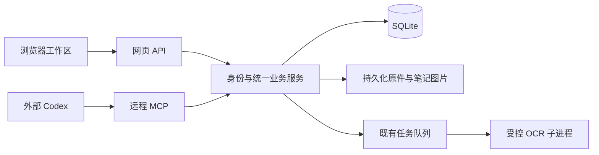

# 个人云端研究工作区与 Codex 接入设计

日期：2026-10-26。状态：用户已于本次会话回复“开始吧”，批准按本稿进入实施；按既定 OpenCode 分工顺序推进并独立验收。

## 1. 目标与决定来源

用户已经确定：个人使用；通过网址跨设备访问同一文献库；先对标 Notion 的工作区体验；优先连接外部 Agent；首个客户端是 Codex。用户已同意保留现有 React、TypeScript、Python 与 SQLite，整体部署到云端并增加 MCP；主站不以 Sites 为必需托管平台。

本稿把技术路线落实为可分阶段验收的产品设计。以下编辑器、首版功能边界、单实例部署及授权细节由 Codex 提出，属于待评阅的设计决定，不冒充用户逐项指定。

目标体验：用户创建研究页面并关联文献，在 Codex 中要求整理；Codex 阅读原文、保存摘录、把带出处的草稿写入页面；用户换设备登录后能继续编辑，并从引用回到对应原页。

第一阶段不是完整复刻 Notion 或 Zotero。保留已有文献处理价值，先建立页面、证据、Agent 共用的内容体系。

## 2. 路线比较与已选方案

| 路线 | 取舍 | 结论 |
| --- | --- | --- |
| 现有 React + Python 整体上云，增加 MCP | 最大程度复用文献与证据代码；需要部署、身份、持久存储与备份 | 用户已同意，采用 |
| Sites 工作区 + 独立 Python 文献服务 | 可用平台托管和身份；需要维护两端的数据、身份与任务衔接 | 本轮不采用 |
| 重写为全 JavaScript 应用 | 可统一语言；需重做已有 Python OCR 与证据链 | 缺少足以抵消重写成本的收益，排除 |

技术组合：React / TypeScript / Vite 前端，Python / FastAPI 内容服务，SQLite 与持久卷，现有受控 OCR 工作进程，远程 Streamable HTTP MCP。云服务商、域名和 OIDC 供应商尚未选定，不购买服务，也不假设已有部署凭据。

## 3. 当前代码边界

- 已有页面：检索、文献库、识别任务、摘录集、设置；研究项目目前是占位页。
- 已有核心：按哈希存原件、原文单元、校订与历史、带偏移和版本的摘录、OCR 候选与人工采用、任务恢复、导出。
- `collections` 是摘录分类集合，不改名冒充页面或研究项目。
- `agent.py` 的四动作研究循环保留；本轮外部接入复用业务函数，不把内置模型循环包装成唯一入口。
- 当前服务只允许环回地址，本机会话不验证公网用户身份。云端必须增加独立模式与全局授权；不能仅放开监听地址或删除 Host 校验。
- 当前前端导航大多存于内存或浏览器会话。新页面与证据引用需要稳定 URL，刷新或从 Codex 打开链接后应恢复目标。

以上来自静态代码调查，不等于当前产品已通过运行验收。

## 4. 首版产品范围

### 4.1 页面与组织

新增“笔记工作区”，保留文献、检索、任务和摘录入口。支持创建、改名、页面/子页面、同级排序、移动、收藏、归档和恢复。页面可以独立存在，也可以关联多份文献与摘录。

页面属性首版固定为标题、标签、阅读/整理状态（未开始、进行中、已完成）、关联文献、更新时间与收藏。提供树形导航和可筛选、排序的页面表格；表格中的一条记录就是一篇页面，共用身份和数据。

不在首版实现通用自定义数据库、公式、汇总、任意属性类型、看板或日历视图。现有“研究项目”占位页可改为引导用户创建专题页面；本轮不增加第二套项目实体或自动研究运行器。

### 4.2 编辑与保存

支持段落、标题、项目符号列表、编号列表、待办、引用、分隔线、网页链接、图片、页面引用、文献引用和证据引用。提供斜杠菜单、块拖动、基本文字样式和键盘操作；中文输入法、粘贴、撤销及触屏基本编辑必须实测。

编辑器建议以 BlockNote 的基础包为起点，使用项目自己定义的受限块格式和适配层，避免业务层依赖编辑器内部对象。只引入完成首版所需的基础能力；不引入内置 AI 或 XL 功能。精确版本和 UI 适配由实施者在 React/TypeScript 兼容检查后锁定，不为安装编辑器擅自升级整套前端。

正文以结构化 JSON 保存，含 `schema_version`、稳定块 ID、类型、属性、行内内容和子块。服务端校验类型、层级、引用目标和尺寸，拒绝不支持的结构，不能悄悄丢掉未知块。首版正文最大 1 MiB、最多 2000 个块、嵌套最多 8 层；超过限制给出可操作错误，保留草稿。

网页自动保存采用页面修订号比较。输入停止约 800ms 后提交；同一页面最多一个在途写请求，后续编辑排队。离开页面或关闭时若未保存，明确提示并保留当前会话中的草稿。网络或会话失效不清空编辑器；重新登录前后均保留当前标签页内的未提交内容。首版不承诺关闭浏览器后恢复未成功保存的离线草稿。

状态明确显示“保存中 / 已保存 / 未保存 / 有冲突”。只在服务端确认后显示已保存。出现冲突时保留本地草稿与服务器最新版，允许查看差异、复制草稿或基于最新版本重新提交；不自动合并，不无提示覆盖。干净页面可每 10 秒检查修订号并刷新；页面失焦或标签页隐藏时暂停轮询，重新聚焦检查一次；有未保存编辑时只提示有新版本。

### 4.3 关联与来源

页面引用按目标 ID 保存，改名或移动不改变引用身份。反向链接来自结构化引用索引；普通外部 URL 不自动猜测成内部关联。页面归档后引用继续显示标题和归档标记，可打开只读内容。

文献引用指向已有文献 ID。证据引用指向已有 evidence ID，显示书名、引文及文件页/印刷页状态，可打开现有阅读器的正确单元。引用显示摘录保存的快照及当前核验状态；OCR 更新不能悄悄改写页面中的已引用文字。

原件、机器识别、人工校订、摘录和用户笔记维持独立语义。Agent 的解释写入笔记，不能作为原文回填。引用待核或过期证据时显式标识，不把它显示成人工核验通过。

图片上传是笔记附件，独立于文献导入：首版接受 PNG/JPEG/WebP/GIF，单文件上限 20 MiB，按内容哈希保存不可变对象，数据库保存归属与引用。下载和显示均经过认证；不从任意外部地址由服务器抓取图片。文献原件继续走现有导入与读取路径。

### 4.4 搜索、历史与导出

统一搜索入口可区分页面、文献和摘录。页面首版为文字关键词匹配，不引入向量检索或语义推荐；复用现有文献检索，不把整个 OCR 索引重写为笔记索引。

每次成功保存记录不可变的页面快照，注明网页或 Codex 来源、时间、操作者及修订号。可查看和恢复历史；恢复创建新的修订，而不回退或删除历史链。归档代替永久删除；首版没有永久清除接口。

页面可导出 JSON 和 Markdown。JSON 保留完整页面正文、属性和关联身份，Markdown 提供可读正文、引用出处与资产相对链接；页面导出包包含笔记图片及引用清单，文献原件仍由资料库管理。首版不包含页面级导入/恢复入口，也不承诺 Markdown 无损往返；恢复通过整库备份完成。保留 JSON 的结构化信息，为以后独立设计页面导入提供基础。此处范围由 Codex 在设计审查后明确。已有摘录 CSV/JSON/Markdown/DOCX 等导出保持原语义。

## 5. 统一内容服务与存储

网页 API 和 MCP 是两个适配入口，调用相同的内容服务。事务、引用校验、版本检查、幂等与历史不分别实现两遍。MCP 不向自己的 HTTP API 绕行，也不开放任意 SQL、文件路径或 shell。

建议新增实体：

| 实体 | 责任与最低字段 |
| --- | --- |
| pages | ID、parent_id、标题、图标、状态、排序、收藏、body_json、schema_version、revision、时间 |
| page_tags / page_documents | 页面固定属性与文献关联 |
| page_revisions | page_id + revision 唯一、完整页面快照、来源、操作者、request_id、时间 |
| page_links | 从当前正文派生的页面/文献/证据引用及源块 ID |
| note_assets | 资产 ID、哈希、相对路径、类型、大小、所属工作区、时间 |
| mutation_requests | 操作者 + request_id 唯一、请求摘要、已提交结果，用于安全重试 |
| cloud_sessions / agent_tokens | 云端浏览器会话及可撤销 Agent 授权，不与内容历史混存 |

单个个人工作区是授权边界，不在本轮建设多租户体系。所有领域对象仍经过该工作区的身份检查；以后加多人时需要另做设计。

页面整个快照是首版存储的权威表示，块 ID 在页面内唯一并跨修改稳定。链接索引、列表属性和搜索派生内容在页面保存的同一事务更新。page body 和属性共用单调递增的 revision，任何变更都不能绕开它。保存空变更可以返回当前结果，不产生假历史。

结构变更不得把页面移动到自己或自己的后代，父页面必须存在且有效。归档父页面时，后代实际可见状态受祖先影响；子页面不被删除。恢复祖先后，原先单独归档的子页面仍保持归档。普通移动不隐式解除归档。

所有写事务先校验再提交；更新页面、引用、历史和幂等记录原子完成。相同操作者以相同 request_id 和相同有效请求重试，返回原结果；若内容不同则拒绝，不复用旧结果掩盖参数变化。失败事务不留下可误判为成功的请求记录。前端每次自动保存与 MCP 每次变更均生成独立 request_id。

沿用 SQLite 外键与短写事务，配置有界锁等待。首版不为云端运行强制启用 WAL；如实施者提出更改日志模式，须先核对实际 SQLite 版本并做写入/备份回归。不允许把活数据库放在跨主机共享网络文件系统上。

## 6. 网页 API 与稳定地址

沿用 `/api/v1`。页面列表/读取、创建、属性修改、正文保存、历史、恢复、归档和资产上传由独立路由模块承担；不继续扩张已有文献路由。更新接口显式接收 `expected_revision` 和 `request_id`。

页面地址为 `/pages/<page_id>`；文献/原文定位地址包含稳定 doc_id/unit_id。前端增加与地址栏同步的路由或导航适配，深链接、刷新与前进后退均能恢复目标；不再仅依赖 sessionStorage 导航。未授权深链接登录后返回同源原地址。

SPA 回退必须排除 `/api/`、`/mcp`、`/auth/` 及授权发现路径，未知服务接口返回对应错误，不能返回网页 HTML 冒充接口结果。

网页启动信息在云端不暴露工作区绝对路径、环境变量或密钥。本地模式保留现有启动器与安全行为；旧“本机服务”文案按运行模式调整。

## 7. Codex 首版 MCP 工具

外部 Codex 负责模型推理；网站提供资料和操作。此闭环不要求网站配置模型 API 密钥，不需要运行既有 `run_research` 循环。

采用当前 Codex 支持的 Streamable HTTP，使用官方 MCP SDK 完成协议处理。精确 SDK 版本及协议兼容性在实施时核对并锁定，不手写一套 JSON-RPC 协议栈。部署后通过真实 Codex 检查握手、工具发现及调用。

建议首版工具名及语义：

| 工具 | 行为 |
| --- | --- |
| workspace_search | 按页面/文献/摘录范围检索，返回对象 ID、类型、摘要、版本和网页链接 |
| page_get | 读取页面属性、正文和修订号；大内容有界分段，显式返回截断信息及继续读取游标 |
| page_create | 创建页面并可设置初始正文、父页与固定属性；必须 request_id |
| page_update_properties | 修改标题、标签、状态、收藏或关联文献；带 expected_revision 与 request_id |
| page_edit_blocks | 按稳定块 ID 原子执行一批插入、替换、移动；带 expected_revision 与 request_id |
| page_get_history | 查询修改来源与历史快照，有界分页 |
| document_get | 读取文献书目、处理状态和原文单元导航 |
| unit_read | 按单元读取原文、有效版本、哈希、文件页与印刷页状态，复用既有证据语义 |
| evidence_create | 保存逐字摘录，使用明确偏移和预期文字哈希；不得编造出处 |
| evidence_get | 读取摘录、版本快照、核验状态与原页入口 |

`page_edit_blocks` 一次最多 100 个操作；稳定 ID 和锚点必须存在且属于指定页面，校验后整批提交，不能半批成功。只操作目标页面内部的块，不通过这个接口跨页迁移整棵块树。网页的删块是正常编辑并进入历史；首版 MCP 不提供删块、归档、历史恢复、永久删除或采用 OCR/校订/证据核验的工具。替换块会记录前后内容，不能修改 evidence 本体。

MCP 读取的默认输出预算为 24000 字符，单次请求可向下缩减。大页面返回不透明游标，游标绑定页面 ID、修订号和当前位置；续读发现版本变化则返回明确冲突，要求重新读取。段落内也可分段，标明字符偏移，不能把截断内容表示为完整页面。页面编辑始终使用真实块 ID，不能凭截断文本猜测整块。

所有写工具返回最终对象 ID、修订号及可打开的页面/原页链接；错误有明确错误码和恢复建议。协议成功或 HTTP 200 本身不代表内容已提交，工具需返回业务结果。

Agent 在一次任务中引用哪些资料由用户的任务范围决定；源文献和检索结果只作为资料，不能新增权限或改变操作范围。正式证据继续使用已有偏移、哈希和版本校验。Agent 可生成待核摘录，但不能替用户确认核验。

## 8. 云端身份与访问

运行模式显式区分 `local` 与 `cloud`。local 保留环回服务和原会话方式；cloud 启动必须具有完整的基础地址、允许 Host、OIDC 和 owner 配置。配置缺失立即失败，绝不退回本地免登录模式。

网页使用成熟库接入标准 OIDC 授权码流程，校验 state、nonce 与 PKCE；实际供应商留到部署时选定。账户以预先配置的 issuer + subject allowlist 固定为用户本人，不按显示邮箱或首个登录者自动授予所有权。应用内没有开放注册。

登录后签发服务端可撤销会话，cookie 为 HttpOnly、Secure、SameSite=Lax。写请求继续要求 CSRF 和同源校验；只信任明确配置的反向代理与允许 Host。所有 API、文件原件、渲染图片、笔记图片、导出与 MCP 都检查授权，不能只保护新页面。

首版 Codex 使用个人访问令牌（PAT），通过 `bearer_token_env_var` 发送，避免把实现 OAuth 授权服务器纳入首版。网页的已登录设置页可以创建、列出并撤销令牌，明文只显示一次；服务端仅保存带服务端密钥的令牌摘要、owner、能力范围、失效/撤销时间和最近使用时间。令牌至少 256 位随机熵，默认 90 天到期，可提前撤销；首版提供只读与页面编辑两种权限，页面编辑包含创建待核摘录。

浏览器 cookie 不能用于 MCP，PAT 不能用于网页会话登录。服务端授权上下文统一映射为同一 owner；令牌泄露时可单独撤销，不要求重建文献库。令牌、session 和密钥不进入日志、导出包、前端长期存储或 Git。具体放入 Codex 进程环境的方式在接通时依据本机实际启动方式验证，不把 token 写进配置正文。

普通页面编辑属于用户授予令牌的日常权限，不增设每次操作都须人工点头的流程。核验与采用等研究决定保持现有人工入口。

## 9. 部署、持久化与任务

首版采用一个云端主机上的单实例应用，部署可用托管容器或兼容主机。构建阶段 Node 编译 React，Python 运行阶段提供同源静态资源、API 和 MCP；容器不依赖开发服务器。

只运行一个 ASGI 服务进程，复用生命周期管理的一套后台任务执行者及工作区 OCR 闸门，避免多副本重复启动任务。SQLite、sources、笔记资产与必要 artifact 均在同一主机持久卷；数据库只通过应用和受控维护命令访问。托管服务必须支持长驻任务、子进程及该持久化语义。暂不水平扩容或为页面编辑增加 Redis/消息集群。

关闭浏览器不会停止云端任务；主机休眠会影响处理，所以部署验收须检查服务持续运行策略。进程退出后依靠现有任务租约和检查点恢复，并验证没有旧进程同时提交。网页进程/worker/OCR 的停止、恢复及资源限制保持明确。

云端入口提供 HTTPS；只有极简健康检查可匿名，内容和诊断保持授权。运行日志记录请求 ID、状态和必要诊断，不打印文献全文、令牌或认证头。

云端 Linux 与当前 Windows 的模型路径、原件路径、字体及依赖差异必须测试，不能以 Windows 单测替代云端验收。实际主机资源根据真实文献样本测量后选择，本稿不承诺容量、速度或价格。

## 10. 迁移、备份与恢复

开发和迁移演练使用合成资料及独立的旧库副本；不直接拿用户日常库做 schema 试验。当前 migrations 已到 v9，正式实施时核对最新版本并追加迁移，保留既有迁移历史与证据关系。禁止以 INSERT OR REPLACE 更新有级联关系的父记录。

迁移前确认实际资料库目录（代码仓库不是资料库）。复制数据库一致快照、全部被引用原件与必要资产，记录 manifest、SHA-256、文献/单元/摘录/校订/候选/任务数量及 ID。`stored_path` 应保持相对工作区路径；历史 `original_path` 可保留为来源信息，云端读取不能再依赖旧盘符。

初次切换时暂停本地库写入并停止相关 worker，产生最终一致快照；先导入全新云端目录并验证，不覆盖本地原库。完成新 schema 后逐项比较数量、ID、哈希、摘录偏移与引用，并抽样打开原页、校订、OCR 候选和导出。核验后把云端设为正式写入点，本地留作封存备份；不实现双向同步。

跨主机迁移与同一云端实例的重启恢复分开处理。首次迁入的非终态任务保留 ID、检查点及动作历史，统一转为已有的“已暂停”状态，附迁移前状态和原因记录，启动云端服务时不自动执行。这是 Codex 在设计审查后提出的默认行为。迁移清单还需覆盖待处理导入所依赖的 staging 文件、已有候选结果及相关 artifact，逐项校验；在迁入副本中清除已停止旧 worker 的租约/进程身份，不能用旧主机 PID 探测新主机进程。

用户点击继续前，服务先检查文件与检查点是否满足续跑条件；满足时沿用现有恢复入口，不重做已提交步骤；缺失时保持暂停，列出缺失项，不把任务冒充为可继续或直接自动失败。不能恢复的任务保留历史，由用户选择补齐资料或重新发起。已完成/已拒绝等终态记录保持原状态。云端上线后的同主机进程重启仍按第 9 节自动恢复规则验收。

使用 SQLite backup API 取得数据库一致快照，并收集该快照引用的不可变文件清单。文件复制以清单为准，校验哈希；不能只复制活数据库主文件。备份与导出不携带生产 OIDC 密钥、PAT 明文或可复用浏览器会话。

建议日备份，保留最近 7 份日备份和 4 份周备份，存到独立于运行盘的位置。具体目的地、执行频率和费用在部署前落实；交付恢复命令和实测恢复报告。没有异地副本和恢复实测时，不宣称备份可靠性已验收。

回退以成对的旧镜像与对应 schema 备份恢复到新目录，并进行只读校验后切换；不直接用旧程序写新版数据库。恢复后云端会话与 Agent token 作废，使用部署配置重新建立登录及授权。回退前应保全切换以来的新内容，不能为了恢复服务静默丢弃新笔记。

## 11. 实施顺序与完成标准

本设计包含三个顺序子项目，各自编写实施计划并验收，避免一次委派跨越所有模块。

| 阶段 | 可单独交付的结果 | 验收重点 |
| --- | --- | --- |
| A 页面与证据工作区 | 在独立本地测试库中完成页面、块编辑、关联、历史、固定属性表格、深链接及导出 | 浏览器真实保存/关闭/重开、中文输入、引用原页、冲突与旧功能回归 |
| B 云端运行基础 | 同一应用以 cloud 模式在隔离环境运行，登录、全局授权、持久卷、后台恢复与备份路径完整 | 未授权访问各类旧新接口失败；重启不丢数据；恢复演练；真实 OIDC 与托管环境单列 |
| C Codex 接入与切换 | 远程 MCP 连接真实 Codex，完成读写和证据闭环，再迁移用户指定资料库 | 真实握手/列工具/读写/撤销令牌/幂等/冲突；另一设备实际登录读回；迁移前后证据一致 |

详细实施计划分阶段列出文件、接口、测试和 runnable 验收命令。Codex 负责计划、审查与独立验收，OpenCode 承担批准范围的实现。合成测试、单元测试、浏览器测试、云端验证和真实 Codex 连接分别记录证据；工作进程报告本身不算通过。

首版端到端成功标准：用户从一台设备创建关联真实文献的研究页面；外部 Codex 读原文、保存待核摘录并把草稿写入页面；网页显示正确修改历史和核验状态；用户从第二台实际设备登录读到同一内容，能回到正确原页并继续编辑。第二个浏览器上下文只能证明会话隔离，不能冒充第二台设备实测。

保留既有 3–5 份 PDF 合计 1000 页的长文献目标，但当前不宣称已达成；对新增页面/Codex 的验收与长批次 OCR 容量验收分别记录，后者不因静态检查或少量页试验自动通过。

## 12. 非目标与部署前事项

首版非目标：多人实时协作、对外公开知识库、完整 Zotero 同步、浏览器抓取插件、通用数据库公式、向量检索、模型训练、内置聊天及无人值守自动研究。

现在可设计并在隔离环境实施，不依赖先购买主机。实际发布前需落实：用户的资料库路径与迁移范围、云服务/资源与预算、域名或稳定 HTTPS 地址、OIDC 账户与 owner subject、备份目的地、Codex 凭据注入方式及第二设备验收条件。涉及实际服务注册、付费或首次迁移时，基于已经完成的可审查结果再处理所需授权。

留给实施者的常规选择：具体路由库、OIDC 与 MCP SDK 的兼容版本、BlockNote UI 适配、内部文件拆分、错误码及游标编码。在不改变上述行为的前提下自行决定并记录；涉及更换数据库、数据格式或首版范围的调整需回到设计。

## 13. 核验来源

- 现有仓库：README、web/app.py、web/security.py、web/statics.py、store.py、migrations.py、agent.py、ingest.py、前端 AppState、API client、ProjectsPage 及既有网页设计。
- [Codex MCP](https://learn.chatgpt.com/docs/extend/mcp?surface=cli)：远程 HTTP、OAuth 与环境变量 Bearer Token 配置；本机 CLI 帮助已核对，尚未接通本项目。
- [BlockNote 项目](https://github.com/TypeCellOS/BlockNote)：块式 React 编辑器与基础包；实际集成和中文输入仍需验收。
- [SQLite Backup API](https://www.sqlite.org/backup.html)：一致数据库快照。
- [SQLite WAL](https://www.sqlite.org/wal.html)：并发与同主机文件系统约束；本设计不强制更改现有日志模式。

## 14. 设计审查记录

2026-10-26，独立工程审查认为其余关键行为足以制定计划，提出两个需要界定的事项：跨主机迁移中的未完成任务，以及页面 JSON 是否意味着包含页面导入。已在第 10 节明确迁入后暂停、完整迁移依赖并在人工继续前预检；在第 4.4 节明确首版只有页面导出，恢复通过整库备份。这两项均标为 Codex 提案，供用户连同设计评阅；没有据此修改产品代码。
